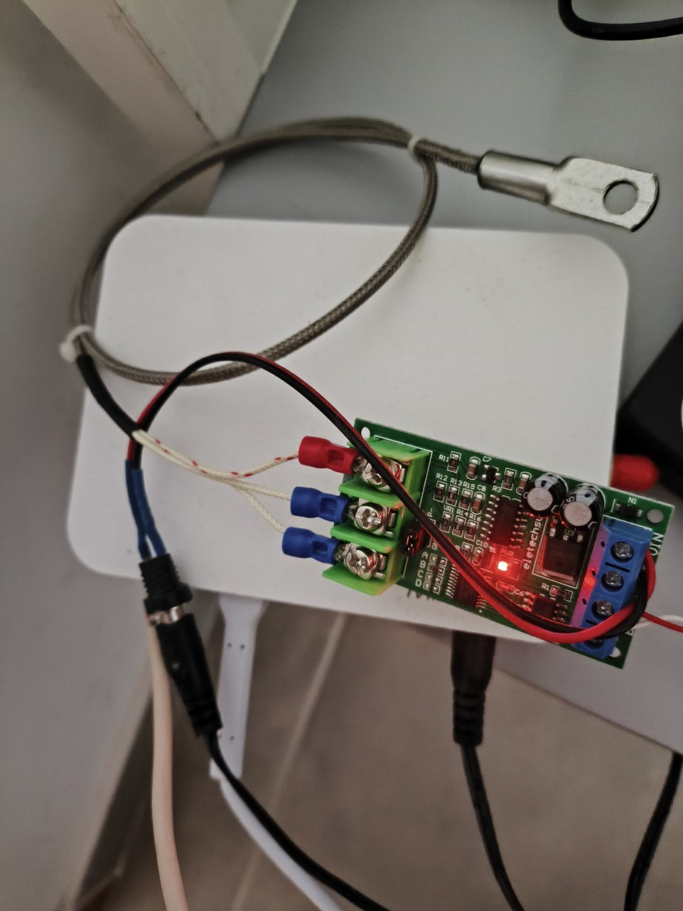

# PTA9B01 PT100 temperature over Modbus RTU with a MikroTik KNOT

Read a PT100 temperature probe through an Eletechsup **PTA9B01** RS-485 module,
using a **MikroTik KNOT** (RouterOS 7) as the Modbus master. The temperature
can be shown on the router console, published to MQTT, or read remotely over
Modbus TCP from any PC on the network.

**Author:** Victor Bolaños Guerra

---

## Contents

| Path | Description |
|---|---|
| `pta9b01.py` | Python client that reads the sensor over Modbus TCP from a PC |
| `temp-show.rsc` | RouterOS script that prints the temperature in the console |
| `temp-mqtt.rsc` | RouterOS script that publishes the temperature to MQTT |
| `mqtt-setup.rsc` | Broker and scheduler setup for the MQTT publisher |
| `docs/PT-100-485-MB-protocol.pdf` | Manufacturer documentation (PT-100-485/MB) |
| `images/` | Photos of the installation and wiring diagram |

## Data flow

```
PT100 probe ──► PTA9B01 ──RS-485 (Modbus RTU, slave 1)──► MikroTik KNOT (RouterOS 7)
                                                              │
              ┌───────────────────────────────────────────────┼──────────────────────────┐
              ▼                                               ▼                          ▼
   Modbus TCP, port 502                          temp-mqtt.rsc (scheduler)     temp-show.rsc
   pta9b01.py on a PC                            publishes to Mosquitto        console output
```

---

## Hardware

| Item | Details |
|---|---|
| Router | [MikroTik KNOT, RB924iR-2nD-BT5&BG77](https://help.mikrotik.com/docs/spaces/UM/pages/41680915/RB924i-2nD-BT5+BG77) |
| RouterOS | 7.25.1 (tested) |
| Sensor module | Eletechsup PT-100-485/MB (PTA9B01) |
| Probe | PT100, 2-wire or 3-wire, stainless steel, 30 mm × 6.5 mm |
| Power | 8–25 V DC (12 V recommended) |
| Range | Version A: -20 to +400 °C · Version B: -20 to +220 °C |
| Accuracy | 1 % |
| Serial | 9600 baud, 8N1 (default) |

### Installation



### Wiring


- **RS-485:** connect the module's **A+** and **B-** to the KNOT RS-485 terminal.
  Swapping A and B prevents communication.
- **Power:** connect **VIN** and **GND** to 8–25 V DC.
- **3-wire probe:** red wire to **P+**, the other two wires to **P-** and **GND**.
  Remove the jumper cap to avoid measurement error.
- **2-wire probe:** red wire to **P+**, blue wire to **P-**. The **jumper cap must be
  closed**, otherwise the probe cannot be measured.
- **Cable length:** above 50 m, add a 120 Ω termination resistor at the end of the bus.

---

## Modbus register map

Source: manufacturer protocol, see [`docs/PT-100-485-MB-protocol.pdf`](docs/PT-100-485-MB-protocol.pdf).

| Address | Content | Unit | Access | Notes |
|---|---|---|---|---|
| `0x0000` | Temperature | 0.1 °C | Read (03) | Signed 16-bit. `255` = 25.5 °C |
| `0x0001` | PT100 resistance | 0.1 Ω | Read (03) | `1000` = 100.0 Ω |
| `0x0002` | Station (slave) address | — | Read / Write (06) | Read via broadcast `0xFF`, write 1–247 |
| `0x0003` | Baud rate | — | Read / Write (06) | 0 = 1200, 1 = 2400, 2 = 4800, 3 = 9600 (default), 4 = 19200, 5 = factory reset |
| `0x0004` | Temperature correction | 0.1 °C | Write only | Enter the correct reading to calibrate |
| `0x0005` | Resistance correction | 0.1 Ω | Write only | Enter the correct resistance to calibrate |
| `0x0006` | Automatic upload interval | s | Read / Write (06) | `0` = query mode (default), `1`–`255` = unsolicited reports |

> **Warning:** writing to `0x0002`–`0x0006` changes the module configuration.
> Do not write to them unless you know what you are doing. Register `0x0006` must stay at `0`
> so the module only answers when the master asks, which the scripts in this repository assume.

### Frame examples (RTU)

Read temperature from station 1:

```
Request : 01 03 00 00 00 01 84 0A
Response: 01 03 02 00 DB F8 1F     → 0x00DB = 219  → 21.9 °C
Response: 01 03 02 FF 90 F2 3F     → 0xFF90 = 65424 → (65424 - 65536) / 10 = -11.2 °C
```

Read PT100 resistance from station 1:

```
Request : 01 03 00 01 00 01 D5 CA
Response: 01 03 02 03 E9 79 3A     → 0x03E9 = 1001 → 100.1 Ω
```

**Negative values** use two's complement: any value above `32767` is negative, and the
temperature is `(value − 65536) / 10`.

---

## Setup on the KNOT

1. Check that the Modbus port is assigned to the RS-485 interface at 9600 baud:

   ```
   /port print
   ```

   The `modbus` port should show `USED-BY: modbus` and `BAUD-RATE: 9600`.

2. Enable the Modbus service:

   ```
   /iot modbus set disabled=no
   /iot modbus print
   ```

3. Confirm that the sensor answers. Replace `slave-id` if your module uses another address:

   ```
   /iot modbus transceive address=1 function=3 data=00000001
   ```

   A working reply has `status: ok` and a value such as `values: 274`, which is 27.4 °C.

---

## Scripts

### Console output (`temp-show.rsc`)

Creates a script that prints the temperature when you run it:

```
/system script run temp-show
```

Output:

```
PTA9B01: 27.4 C
```

### MQTT publisher (`temp-mqtt.rsc`, `mqtt-setup.rsc`)

1. Create the script. Paste the content of `temp-mqtt.rsc` as the `source`, escaping quotes as
   shown in the file comments, or create it from the RouterOS Scripts menu.
2. Adjust the broker address in `mqtt-setup.rsc` to your Mosquitto IP, then run its commands:

   ```
   /iot mqtt brokers add name=mosquitto address=<broker-ip> port=1883 auto-connect=yes
   /iot mqtt connect broker=mosquitto
   /system scheduler add name=temp-mqtt-sched interval=30s on-event=temp-mqtt
   ```

3. Subscribe from a PC to see the values:

   ```
   mosquitto_sub -h <broker-ip> -t "knot/#" -v
   ```

Each message is plain text, for example `knot/pta9b01/temp 27.5`.

### Python client (`pta9b01.py`)

Reads the sensor over Modbus TCP, so the KNOT acts as a gateway from RS-485 to TCP port 502.
Uses only the Python standard library.

```
python3 pta9b01.py 192.168.88.1
python3 pta9b01.py 192.168.88.1 --interval 5
```

Options: `--port`, `--unit` (slave ID), `--register`, `--timeout`, `--interval`.

Example output:

```
12:14:14  raw=   275  temperature=27.5 C
```

---

## Troubleshooting

| Symptom | Likely cause |
|---|---|
| `connection refused` | The Modbus service on the KNOT is disabled (`/iot modbus print`) |
| `no response (timeout)` | No power, A/B reversed, or wrong slave ID |
| `Modbus exception 2` | The register address does not exist on this module |
| `cannot multiply integer number by ip address` | Decimal literals such as `0.1` are read as IP addresses in RouterOS. Use integer arithmetic, as the scripts do |

---

## Notes and limitations

- Accuracy has not been compared with a calibrated reference thermometer. The manufacturer
  states 1 %.
- Register `0x0001` (resistance) is documented but not used by these scripts.
- The temperature correction register `0x0004` has not been changed.
- Modbus TCP is pull-based: a client has to ask for the value. The MQTT script publishes on a schedule.

---

## Sources

- [RB924i-2nD-BT5&BG77 product documentation](https://help.mikrotik.com/docs/spaces/UM/pages/41680915/RB924i-2nD-BT5+BG77)
- [RouterOS Modbus manual](https://manual.mikrotik.com/docs/internet-of-things/modbus/)
- [RouterOS MQTT manual](https://manual.mikrotik.com/docs/internet-of-things/mqtt/)
- [PT-100-485/MB protocol (manufacturer PDF)](docs/PT-100-485-MB-protocol.pdf)
